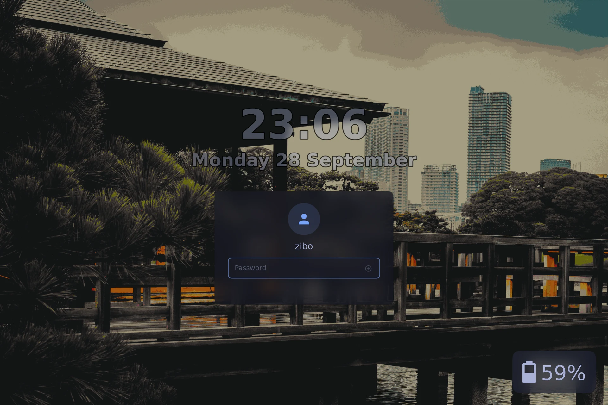
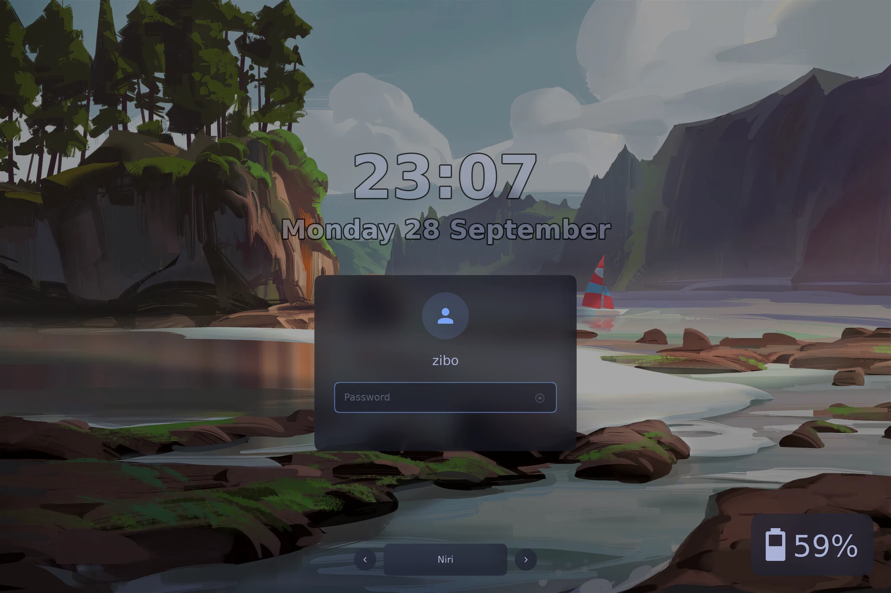
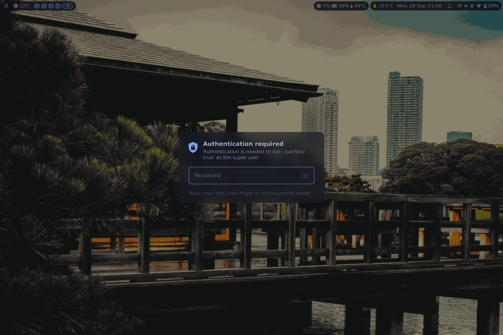

<h1 align="center">
  <picture>
    <source media="(prefers-color-scheme: dark)" srcset="assets/wordmark-dark.svg">
    
  </picture>
</h1>
<p align="center">A lock screen, greetd greeter and polkit agent for Wayland.</p>
<p align="center">
    <a href="LICENSE"></a>
</p>

> [!NOTE]
> This project has been developed with the assistance of AI.

<p align="center">
  
</p>
<p align="center">
  
  
</p>

## ✨ Features

- Lock screen through `ext-session-lock-v1`, one surface per monitor, hotplug included
- greetd greeter with a user picker and a session picker
- polkit agent, with the lock screen's card as its dialog
- Password through PAM, fingerprint through fprintd (lock screen only)
- Wallpaper with blur and dim, frosted cards, and a clock
- Battery indicator
- Multi-monitor: choose which monitors show the controls
- Remembers the last user and session in the greeter
- Preview mode to try a theme without locking

## 🛠️ Install

```sh
scripts/install.sh             # lock screen (the default)
scripts/install.sh --greeter   # greeter
scripts/install.sh --polkit    # polkit agent
scripts/install.sh --all       # all three
```

Modes combine: `scripts/install.sh --lock --polkit`.

The script builds allock and installs it to `/usr/local/bin`, then what each
mode needs: the PAM policy `pam/allock` to `/etc/pam.d/allock` for the lock
screen, the greeter's config under `/etc/greetd`, and the polkit agent's user
service `allock-polkit.service`, not enabled. Icons need the `Symbols Nerd Font`.

See [docs/SETUP.md](docs/SETUP.md) to use it as your lock screen and as your
login screen.

## ⚙️ Configuration

allock works without a config file. To change it, copy
[`config.example.toml`](config.example.toml) to `~/.config/allock/config.toml`:
every key is optional and shown with its default.

The layout is fixed. The config chooses colours, wallpaper, clock format, which
indicators appear and which monitors show the controls.

## 🔑 Authentication

The lock screen checks your password through PAM, with the policy in
`/etc/pam.d/allock` that `scripts/install.sh` installs. Without it allock
borrows `system-auth`, `common-auth` or `login`, in that order, and says so in
its log. With none of them it refuses to lock, rather than lock you out.

The policy includes only `system-auth`: the password check (`pam_unix`) and the
limit on wrong attempts (`pam_faillock`). It leaves out the checks for a new
login, like `/etc/nologin` or a shell missing from `/etc/shells`, which would
otherwise keep you out of a session that is already running.

Wrong passwords count: by default three in fifteen minutes lock the account for
ten (`/etc/security/faillock.conf`). A fingerprint still unlocks, because it is
checked by fprintd outside PAM. `faillock --user $USER --reset`, as root, clears
the count. While the account is locked, the lock screen and the polkit dialog
say so as soon as they appear, and for how long, reading the count the way
`faillock` does. It is a warning: the field stays open, and PAM decides.

With `fingerprint = true` (the default) the fingerprint works alongside the
password: either one unlocks. Set it to `false` to require the password. The
greeter always asks for the password, and greetd checks it with its own policy,
`/etc/pam.d/greetd`.

## 🔒 Lock screen

```sh
allock             # lock
allock --preview   # draw the lock screen without locking, exits on a correct password
```

Bind `allock` to a key in your compositor, and to your idle daemon's lock and
lid actions.

## 🚪 Greeter

`allock --greeter` runs inside a compositor started by greetd. With
`scripts/install.sh --greeter` the setup is:

```toml
# /etc/greetd/config.toml
[default_session]
command = "systemd-cat -t allock-greeter niri -c /etc/greetd/allock-niri.kdl"
user = "greeter"
```

The greeter's own options go in `/etc/greetd/allock.toml` under `[greeter]`.
[docs/SETUP.md](docs/SETUP.md) has the details.

## 🛡️ Polkit agent

`allock --polkit` is the authentication agent for your session: when a program
asks polkit for permission (`pkexec`, a disk to mount, a system setting), it
shows the lock screen's card on a dimmed screen with what is being asked. The
dialog is modal: it keeps the keyboard until you answer, or cancel with
Escape.

It runs as a user service, instead of any other agent (only one can hold a
session):

```kdl
// ~/.config/niri/config.kdl
spawn-at-startup "systemctl" "--user" "start" "allock-polkit"
```

polkit checks the password itself, with `/etc/pam.d/polkit-1`, through its
helper. allock only passes the answers on, so the policy there decides what
works: with `pam_fprintd` in it, the dialog asks for your finger first. Typing
the password still works while it waits, and is checked once the reader gives
up (`pam_fprintd`'s `timeout=` option sets how long that takes).
